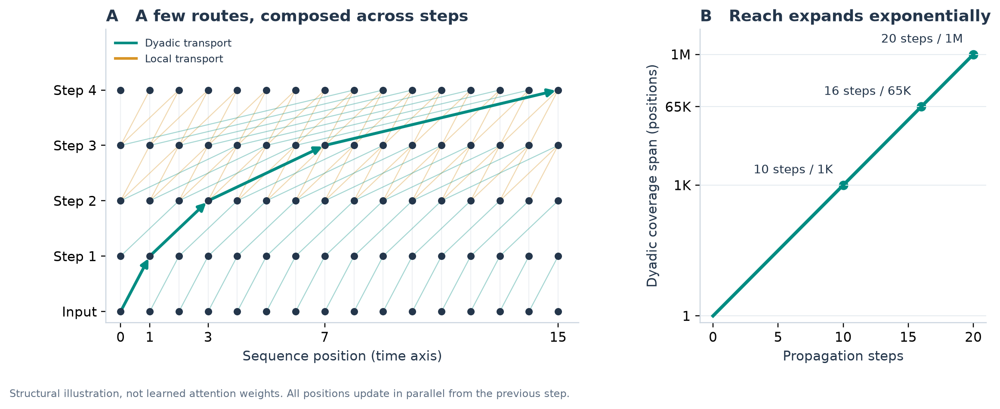
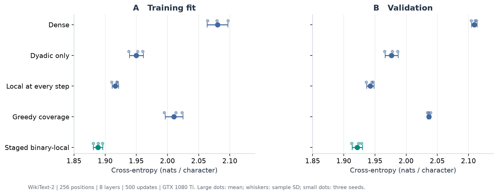
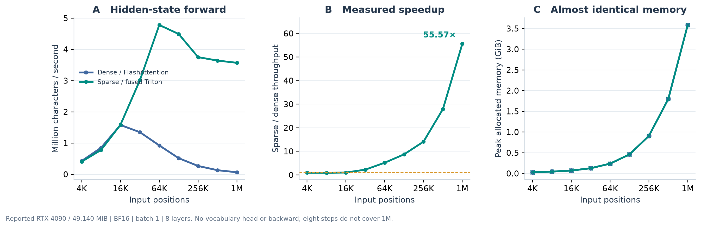
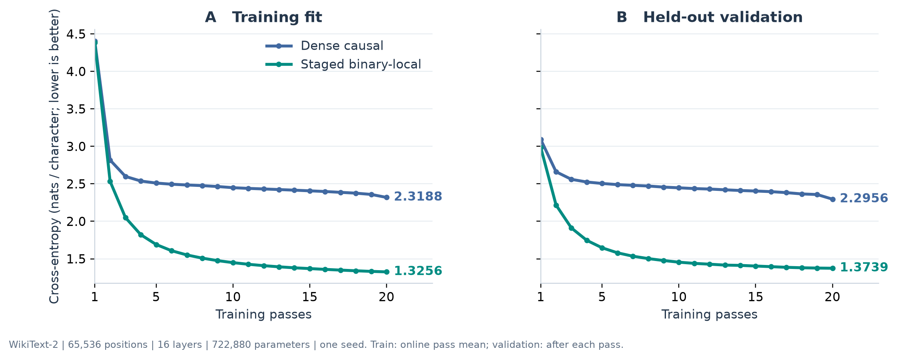
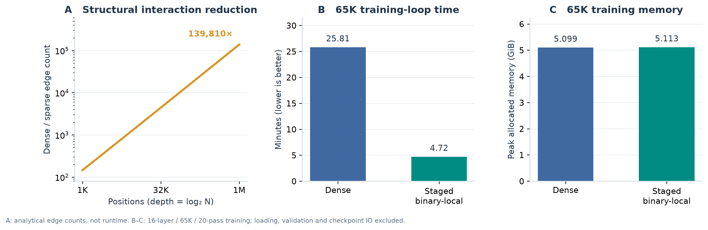

# Staged Binary-Local Diffusion Attention: Effective Few-Step Diffusion Along the Time Axis

HaoyangMa  
haoyang@haoyangma.com

Research manuscript · October 2026

## Abstract

Can useful sequence representations be formed by diffusing information along the time axis in a small number of steps, rather than repeatedly comparing every position with its entire prefix? We test this hypothesis using Staged Binary-Local Diffusion Attention. Each layer is a parallel, learned propagation step: a dyadic jump carries already-contextualized information across an expanding temporal span, while a small local route maintains neighboring interactions. At most four sources are read per position per step, and binary path composition provides complete prefix reachability in logarithmically many steps. On a fixed PG-19 subset, fifteen layers, maximum 32,768-character windows, and twenty training passes yield three-seed mean train/test cross-entropy of 1.3076/1.4330, compared with 1.4395/1.5558 for parameter-matched dense attention. A repository-disjoint Python subset of The Stack Smol reverses this result: sparse train/test cross-entropy is 1.2262/1.4252 versus dense 0.7662/0.8394, and test accuracy is lower by 15.98 percentage points. Few-step temporal diffusion is therefore effective in the tested book setting, but not a universally equivalent substitute for dense interactions. Separately, a matched twenty-layer million-position forward benchmark uses approximately 139,810 times fewer graph interactions and measures 476.58× lower attention-interaction GPU kernel time and 56.01× faster backbone wall time, with nearly unchanged peak allocated memory. The latter includes FFNs, projections, and normalization but excludes the vocabulary head, backward pass, and optimizer. Structural savings, learning effectiveness, and engineering speed are distinct findings; neither fixed-budget training experiment establishes convergence.

## 1. Introduction

Attention can be viewed as information transport between sequence positions. Dense causal attention implements this transport by comparing each query with every position in its prefix. A different approach is to organize a smaller set of direct interactions so that information travels through intermediate states across layers.

Our central hypothesis is that **few-step diffusion along the time axis can form effective contextual representations without dense all-prefix interaction at every layer**. A source state already contains information collected in preceding steps, so a new step can transport that contextualized state instead of individually revisiting all of its original sources. The sequence axis supplies the propagation geometry; network depth supplies the diffusion steps. Here, “few” means logarithmically many scale-expanding steps, not fewer layers than the matched dense model.

This is first a question about representation and learning, and only then about acceleration. We evaluate effectiveness using next-character training and validation cross-entropy, while separately proving structural coverage. We subsequently measure whether the smaller interaction budget translates into faster execution. Removing arithmetic does not automatically remove kernel launches, memory traffic, projections, or feed-forward computation.

We investigate a staged graph with two complementary routes. A dyadic route expands reach through offsets of 1, 2, 4, 8, and so on. A local route, introduced after the first two layers, preserves immediate-neighbor mixing. Attention weights remain content-dependent, while source indices are deterministic.

Our contributions are:

1. A formulation of few-step temporal diffusion as learned causal message passing, with constant source count and logarithmic-depth prefix coverage.
2. Paired three-seed, depth-sufficient accuracy comparisons on a fixed PG-19 book subset and a repository-disjoint Python subset of The Stack Smol, demonstrating both a natural-language benefit and a substantial code-domain deficit. Earlier WikiText-2 experiments document exploratory schedule selection.
3. A secondary systems study against fused dense attention, including a matched twenty-layer million-position benchmark that separates attention-interaction kernel time from backbone wall time, fixed model costs, and memory.

The evidence has three distinct roles: path coverage establishes that the proposed transport routes exist; language-model losses establish that the mechanism can learn useful representations; throughput measurements establish its current engineering benefit. The latter does not substitute for the former two.

## 2. Related Work

Sparse connectivity is an established alternative to dense attention. [Sparse Transformer](https://arxiv.org/abs/1904.10509) studies fixed and strided factorizations. [Longformer](https://arxiv.org/abs/2004.05150) combines local windows with global attention. [LongNet](https://arxiv.org/abs/2307.02486) uses geometrically dilated attention to expand long-range access. [PowerAttention](https://arxiv.org/abs/2503.03588) explicitly studies power-of-two sparse connectivity and receptive-field growth. These works already establish the broader motivation for sparse, multiscale information transport.

Our method selects a single dyadic scale per layer, rather than exposing every dyadic scale in each layer. It operates on individual token states, without segment summaries, sink tokens, or content-dependent routing. Local sources are added only after the first two layers. We treat this as a restrictive design and implementation point within existing sparse-attention research, not as the invention of logarithmic reachability or exponential dilation.

Meta's **Llama 4 local attention** is another relevant reference. Its [official implementation](https://github.com/meta-llama/llama-models/blob/main/models/llama4/model.py) supports causal attention within non-overlapping chunks in RoPE layers, interleaved with global attention in NoPE layers. This provides a production-model example of separating local organization from broader contextual access. The distinction is in the transport mechanism: Llama 4 retains global-attention layers, whereas our method uses a few exact local sources and layer-indexed dyadic propagation to obtain broad path coverage without a dense global-attention layer. This is a related architectural reference, not a Llama 4 reproduction or measured baseline in our experiments.

[FlashAttention](https://arxiv.org/abs/2205.14135) addresses a different issue: it computes exact dense attention with IO-aware tiling and avoids materializing the full score matrix. It therefore provides an essential reference. Comparing against an unfused dense implementation would conflate graph sparsity with avoidable implementation overhead.

## 3. Method: Learned Diffusion Along the Time Axis

Each step updates all positions simultaneously from states produced by the previous step. It is not a left-to-right serial sweep. Attention determines how much content to transport along each available temporal route; the residual stream carries the accumulated representation into the next step. The jump scale doubles across steps, allowing intermediate contextual states to relay information over progressively larger distances.

### 3.1 Source schedule

Let positions be zero-indexed and layers be one-indexed. Define the layer jump as

\[
\delta_\ell = 2^{\ell-1}.
\]

The offsets available to layer \(\ell\) are

\[
O_\ell =
\begin{cases}
\{0,\delta_\ell\}, & \ell\leq 2,\\
\{0,1,2,\delta_\ell\}, & \ell\geq 3.
\end{cases}
\]

For destination position \(i\), the valid source set is

\[
S_\ell(i)=\{i-o : o\in O_\ell,\;o\leq i\}.
\]

Every edge is causal. Sources outside the left boundary are masked, not replaced by valid attention edges. The graph uses two sources in the first two layers and at most four thereafter.

### 3.2 Attention and residual computation

For each head, ordinary scaled dot-product attention is applied over the selected sources:

\[
\alpha_{ij}^{(\ell)}=
\frac{\exp(q_i^{(\ell)}\cdot k_j^{(\ell)}/\sqrt{d_h})}
{\sum_{u\in S_\ell(i)}\exp(q_i^{(\ell)}\cdot k_u^{(\ell)}/\sqrt{d_h})},
\qquad
z_i^{(\ell)}=\sum_{j\in S_\ell(i)}\alpha_{ij}^{(\ell)}v_j^{(\ell)}.
\]

The backbone uses pre-normalized residual attention and SwiGLU feed-forward blocks, a final RMSNorm, and tied input/output embeddings. Query and key head normalization and rotary position encoding are retained in both comparison paths. In the reported long-context configurations, query and key/value head counts are equal; grouped-query support in the implementation is not an additional experimental advantage.

There is no token pooling or explicit key/value compression. Nevertheless, a distant message is transformed through intermediate states; exact source selection does not imply lossless preservation of every historical feature.

The term *diffusion* refers to learned information propagation through the graph. This is not a denoising diffusion model, and no physical conservation law is imposed.

### 3.3 Prefix reachability

The dyadic scaffold alone is sufficient for coverage. Any offset \(r<2^L\) has a binary expansion

\[
r=\sum_{\ell=1}^{L}b_\ell 2^{\ell-1},\qquad b_\ell\in\{0,1\}.
\]

Choosing either a self edge or a dyadic edge at each layer produces a path with that offset. All intermediate positions remain valid whenever the starting source is nonnegative. Thus an \(L\)-layer stack has paths from every prefix position within a span of \(2^L\) positions. Added local edges cannot remove these paths.

This guarantees structural reachability, not dense-attention equivalence or successful retrieval. Ten layers suffice for a 1,024-position span; fifteen for 32,768; sixteen for 65,536; twenty for 1,048,576. The primary accuracy tests and updated twenty-layer systems test use coverage-sufficient depth. The historical eight-layer million-position forward benchmark and four-layer training pilot do not.



*Figure 1. Few-step diffusion along the time axis.* Left: four simultaneous propagation steps over sixteen positions. Teal edges carry dyadic messages; gold edges provide local mixing from step three onward. The highlighted path relays information from position 0 to position 15 through jumps of 1, 2, 4, and 8. Right: the dyadic scaffold's guaranteed coverage span grows exponentially with depth. The diagram represents available routes, not learned attention weights.

### 3.4 Interaction complexity

Dense causal attention uses

\[
E_{\mathrm{dense}}=L\frac{N(N+1)}{2}
\]

query–key interactions per head across the stack. The sparse graph uses

\[
E_{\mathrm{sparse}}=
\sum_{\ell=1}^{L}\sum_{o\in O_\ell}\max(N-o,0).
\]

For fixed width and depth, sparse interaction work is linear in \(N\). If depth increases to maintain full coverage, \(L=\lceil\log_2N\rceil\), stack interaction work is \(O(N\log N)\). Projection and feed-forward costs remain.

For \(N=2^L\) and \(L\geq2\), the edge count simplifies to

\[
E_{\mathrm{sparse}}=(4L-5)N-3L+7.
\]

| Positions | Coverage-sufficient layers | Dense/sparse edge ratio |
|---:|---:|---:|
| 1,024 | 10 | approximately 146.5× |
| 8,192 | 13 | approximately 1,133× |
| 1,048,576 | 20 | approximately 139,810× |

At the final setting, sparse interactions are approximately 0.000715% of dense interactions. These ratios count graph edges, not measured runtime or useful information.

## 4. GPU Implementation

The reference sparse path gathers source states, computes scores, normalizes weights, and reduces values using ordinary tensor operators. Although mathematically small, this sequence introduces multiple launches and temporary tensors.

The fused Triton path combines source loads, score calculation, softmax, and weighted-value accumulation. Query rows are processed in blocks, and intermediate score/reduction state stays inside the kernel instead of becoming a global gathered tensor. Softmax and accumulation use FP32 internally for BF16 inputs. A key-oriented backward implementation reorganizes gradient accumulation to reduce conflicting writes. Irregular masked or seam-reset cases have a reference fallback; the reported performance tests use the regular all-valid case.

The dense reference calls PyTorch scaled dot-product attention with causal semantics. The recorded profiler identifies `aten::_scaled_dot_product_flash_attention`, confirming fused FlashAttention dispatch. Neither path uses `torch.compile` in the reported remote experiments.

Fusion reduces overhead but cannot eliminate the residual stack, projections, normalization, FFNs, vocabulary logits, or data movement. Sparse kernels also have a different arithmetic intensity from dense tiled matrix multiplication. These remaining costs motivate direct measurement rather than extrapolation from edge ratios.

## 5. Experimental Protocol

### 5.1 Dataset and objective

The primary accuracy comparisons use two fixed custom subsets: PG-19 books and Python files from The Stack Smol. Both use next-character prediction, ordinary full-vocabulary cross-entropy in nats per character, and training-only character vocabularies with an unknown entry. Character perplexity is not an official word-level PG-19 score or a code-generation benchmark score.

PG-19 selection ranks object keys by SHA256 of `pg19-mini-v1:` plus the key within each official split, selecting 30 train, 5 validation, and 5 test books. Raw downloaded character totals are 10,877,012 / 1,105,235 / 1,957,650; universal-newline conversion gives 10,663,144 training targets per pass and 1,921,910 test targets. Books are not concatenated. The vocabulary has 187 entries including UNK; validation/test unknown rates are 0.00046098% / 0.00067641%.

The Stack Smol uses its Python JSON file at revision `4a6938ce94446f324c6629e7de00ac591710044b`. Normalize line endings and remove exact duplicate content globally, then hash repository identities into 80/10/10 partitions. Select hash-ranked whole repositories to approximately match the PG-19 character budgets. Train/validation/test contain 1,261 / 138 / 248 files from 1,165 / 134 / 234 repositories, with 10,888,182 / 1,110,223 / 1,963,664 characters. Repository and exact-content overlaps are absent; near-duplicate forks are not guaranteed absent. The vocabulary has 1,192 entries; validation/test unknown rates are 0.01837% / 0.04089%. Median training file length is 2,769 characters and only 56 training files exceed 32K, so this is a code-domain test, not an exclusively long-context workload.

Both comparisons use at most 32,768 input characters plus one shifted target character, preserving short samples and partial tails. Consecutive windows share only the boundary character; each within-document transition is scored once per pass. No attention crosses book/file or window boundaries. PG-19 uses no padding. Code inputs are right-padded to power-of-two buckets from 128 to 32K to bound Triton specialization; padded targets are ignored by CE and accuracy. All metrics weight only real character transitions. Prefix-invariance checks confirm that changing future tokens does not change earlier outputs.

Historical exploratory experiments use WikiText-2 raw and a 1,014-entry long-context vocabulary. Those older runs concatenate each split into a stream, can cross article boundaries, and drop incomplete tails. They are retained as historical evidence, not the primary natural-document accuracy protocol.

### 5.2 Hardware and measurement

The updated twenty-layer systems benchmark and PG-19/Stack Smol comparisons run on an **NVIDIA GeForce RTX 4090 reporting 24,564 MiB** total memory, driver **610.43.03**, with the existing CUDA 13.0/PyTorch 2.14.0+cu130 environment. Historical remote WikiText and eight-layer scaling records report **49,140 MiB**, approximately 48 GiB; this older server configuration must not be conflated with the updated 24 GB measurements. Earlier topology studies ran on a GTX 1080 Ti.

Remote experiments use batch size one and BF16 autocast, without `torch.compile`. The updated twenty-layer forward test uses one warmup, three synchronized unprofiled timings (median wall time), and one separate profiler iteration. Attention time is the sum of GPU interaction-kernel times across the stack, not standalone attention wall time. Backbone wall time includes embeddings, projections, normalization, and FFNs, but excludes the vocabulary head, backward pass, and optimizer. Historical eight-layer scaling uses two warmups and three timings.

Training times are sums of timed training loops, including forward, cross-entropy, backward, clipping, optimizer updates, transfers, and per-update synchronization. First-use kernel compilation inside these loops is included. **Dataset loading, model construction, validation passes, and checkpoint serialization are not included.** Thus the reported values are training-loop time, not complete job turnaround time. Peak memory means CUDA peak allocated memory, not reserved memory or total device occupancy.

### 5.3 Configurations

| Experiment | Width | Layers | Heads | FFN hidden | Vocabulary | Parameters per model | Budget |
|---|---:|---:|---:|---:|---:|---:|---|
| PG-19-mini accuracy | 64 | 15 | 4 | 128 | 187 | 628,832 | 20 passes × 3 seeds |
| Stack Smol Python accuracy | 64 | 15 | 4 | 128 | 1,192 | 693,152 | 20 passes × 3 seeds |
| Matched 1M forward | 96 | 20 | 4 | 256 | 6,400 | 2,831,136 | 1 warmup + 3 forwards + profile |
| Forward scaling | 96 | 8 | 4 | 256 | 6,400 | 1,501,152 | 2 warmups + 3 forwards |
| 1M training pilot | 64 | 4 | 4 | 128 | 1,014 | 229,440 | 3 passes, 30 updates |
| 65K training | 64 | 16 | 4 | 128 | 1,014 | 722,880 | 20 passes, 3,320 updates |

Parameter counts above are independently recomputed from the current configuration code; the raw long-context JSON files do not store parameter counts. Dense and sparse counts match. The forward inputs are synthetic random IDs, not a language-quality evaluation.

The primary comparisons use seeds 1, 2, and 3. Conceptually corresponding parameters receive identical initialization by canonical parameter name and paired seed, and per-pass sample permutations match. AdamW uses learning rate 3×10⁻⁴, weight decay 0.01, clipping at norm 1, no dropout, and no learning-rate scheduler. Evaluate validation after every pass and select the lowest-validation-CE checkpoint; then separately evaluate train and test at that checkpoint. Save rolling model and optimizer state every 500 updates. Report arithmetic means and sample standard deviations across seeds. Historical WikiText long-window comparisons use one seed and the older driver's optimizer defaults.

## 6. Results: Learning Effectiveness and Execution Cost

The primary effectiveness evidence is the paired PG-19 and Python comparison in Section 6.5. Section 6.2 reports the updated coverage-sufficient twenty-layer systems test alongside historical scaling; Sections 6.1, 6.3, and 6.4 retain exploratory results with their original protocols.

### 6.1 Topology screening at short context

Before the long-context tests, internal schedules were compared for 500 updates, batch size eight, context 256, width 96, eight layers, four heads, and FFN hidden width 256 on a GTX 1080 Ti. Each model had 984,096 parameters. The following three-seed results summarize the main design choices; ± denotes the recorded between-seed variation, not a confidence interval.

| Route | Mean last-10 train CE | Validation CE | Throughput, characters/s |
|---|---:|---:|---:|
| Dense | 2.0802 ± 0.0135 | 2.1092 ± 0.0036 | 53,200 |
| Dyadic only, H0 | 1.9500 ± 0.0092 | 1.9766 ± 0.0085 | 59,000 |
| Local + dyadic at every layer, H1 | 1.9162 ± 0.0041 | 1.9425 ± 0.0048 | 57,700 |
| Greedy coverage schedule, H4 | 2.0105 ± 0.0117 | 2.0366 ± 0.0020 | 51,200 |
| Staged binary-local, H8 | **1.8885 ± 0.0061** | **1.9215 ± 0.0066** | 57,900 |

The staged schedule is the method evaluated in the later remote tests. The greedy route's stronger graph coverage did not translate into lower loss. This screening supports retaining local mixing, but it does not establish that a minimum edge count, maximum coverage, or minimum repeated-edge rate independently predicts quality. Routes differ in several coupled properties, and the schedule was selected using these results.



*Figure 2. Propagation schedule affects learning quality.* Large markers show three-seed means, whiskers show sample standard deviations, and small markers show individual runs. Training uses the mean of the final ten updates; validation uses the recorded validation CE. The staged schedule has the lowest mean loss among these five routes. Both panels show the same five configurations; lower is better.

### 6.2 Long-context hidden-state forward throughput

The updated matched test uses twenty layers at 1,048,576 positions, width 96, FFN hidden 256, four heads, and batch one on the 24 GB server. Both graphs have sufficient structural depth. Dense FlashAttention versus fused sparse Triton measures **40,902.827 ms versus 85.826 ms** in attention-interaction GPU kernels, or **476.580×**. Synchronized backbone median wall times are **41,491.949 ms versus 740.775 ms**, or **56.012×**. Peak allocated memory is **3.213815 versus 3.213824 GiB**, effectively equal. The approximately 139,810× edge reduction applies to this same depth; it is neither a whole-model FLOP reduction nor a prediction of wall-time speedup. Inputs are synthetic GPU-resident IDs; the benchmark establishes execution cost, not million-position language capability.

The following eight-layer measurements are retained as a **historical scaling sweep**, not the source of the updated twenty-layer headline figures:

| Context | Dense characters/s | Sparse characters/s | Speedup | Peak allocated GiB, dense / sparse |
|---:|---:|---:|---:|---:|
| 4,096 | 426,022 | 404,410 | 0.95× | 0.028 / 0.028 |
| 8,192 | 849,205 | 777,500 | 0.92× | 0.043 / 0.043 |
| 16,384 | 1,577,368 | 1,585,836 | 1.01× | 0.069 / 0.069 |
| 32,768 | 1,348,206 | 3,009,886 | 2.23× | 0.125 / 0.125 |
| 65,536 | 924,043 | 4,780,205 | 5.17× | 0.237 / 0.237 |
| 131,072 | 515,188 | 4,492,494 | 8.72× | 0.460 / 0.460 |
| 262,144 | 266,107 | 3,750,987 | 14.10× | 0.906 / 0.906 |
| 524,288 | 130,507 | 3,641,245 | 27.90× | 1.799 / 1.799 |
| 1,048,576 | 64,231 | 3,569,581 | **55.57×** | 3.584 / 3.584 |

Both paths fit the million-position input. The sparse path is slower at 4K and 8K, reaches approximate parity at 16K, and gains substantially thereafter. Dense FlashAttention remains memory-feasible while its quadratic arithmetic increasingly dominates time.

The eight-layer model does not provide full million-position sparse reachability. This table is a systems benchmark, not evidence of million-position semantic capability, autoregressive decoding speed, or the performance of a large production model.



*Figure 3. The practical benefit grows with input length.* The fused sparse path crosses approximate throughput parity near 16K and reaches 55.57× at 1M, while both paths use almost identical peak allocated memory. These are eight-layer hidden-state forwards, excluding the vocabulary head and backward pass. The reported GPU is an RTX 4090 with 49,140 MiB memory; this shallow test does not establish full-window reachability.

### 6.3 Million-position training pilot

The training stream supplies ten complete windows per pass, with 433,131 trailing target positions omitted. Three passes correspond to 31,457,280 target characters and thirty optimizer updates per model.

| Model | Pass 1 train CE | Pass 2 train CE | Pass 3 train CE | Training-loop seconds | Characters/s | Peak GiB |
|---|---:|---:|---:|---:|---:|---:|
| Dense causal | 6.5671 | 6.1880 | 5.8487 | 813.4 | 38,700 | 29.515 |
| Staged binary-local | 6.5823 | 6.1715 | 5.8294 | 12.3 | 2,549,196 | 29.546 |

The measured training-loop gain is approximately 65.9× including first-pass compilation. Sparse passes two and three reach approximately 3.52 million characters/s, around 91× the dense steady-state throughput. Losses are similar at this very early optimization stage.

This historical pilot has no held-out evaluation, and four layers are insufficient for full-window sparse coverage. Its purpose is execution feasibility and training throughput. The current training script subsequently gained a mandatory validation-window check; reproducing this older pilot requires accounting for that script-version difference, since WikiText-2 validation does not provide a complete 1M window.

### 6.4 Historical WikiText validation: sixteen diffusion steps over a 65K window

At 65,536 positions, sixteen layers provide complete dyadic path coverage. Training uses 166 complete windows per pass: 10,878,976 target characters per pass and 217,579,520 over twenty passes. The training tail drops 39,915 target positions. Validation uses the separate `wiki.valid.raw` split with seventeen complete windows, omitting 30,635 trailing target positions.

| Model | Pass 1 train CE | Pass 20 train CE | Pass 20 validation CE | Training-loop seconds | Characters/s | Peak GiB |
|---|---:|---:|---:|---:|---:|---:|
| Dense causal | 4.4062 | 2.3188 | 2.2956 | 1,548.7 | 140,500 | 5.099 |
| Staged binary-local | 4.3815 | **1.3256** | **1.3739** | **283.3** | **767,946** | 5.113 |

In this historical experiment, sixteen sparse temporal diffusion steps support effective language modeling over a structurally covered 65K window. Final-pass train CE is lower than the dense reference by 0.9932 nats, and validation CE by 0.9217 nats. Training CE is the mean of online losses during the pass, not a frozen final-checkpoint reevaluation; validation CE is evaluated after the pass. As a separate practical benefit, sparse training is 5.47× faster in the measured loops. Because the stream crosses article boundaries, this experiment does not establish performance on natural 65K documents.

The result shows lower loss at a matched token/update budget, not matched-quality speed or converged asymptotic superiority. Neither model is proven to have reached its best attainable loss. No WikiText test-set result is reported.



*Figure 4. Historical WikiText learning curves.* At 65,536 positions and sixteen layers, the staged route has complete dyadic path coverage and achieves lower train and validation CE than the parameter-matched dense reference. Curves are read directly from all twenty saved pass records, without smoothing. Training is the online pass mean; validation is measured after each pass. One seed is available. This stream-based experiment is not the primary natural-document comparison.

### 6.5 Primary accuracy comparison: books versus code

Both tasks use fifteen layers and the same twenty-pass budget per paired seed. Train below is a separate evaluation at the best validation checkpoint, not the online training-pass average. CE dispersion is sample standard deviation across three seeds; accuracy is the mean next-character accuracy. These are custom subsets, not full official benchmark results.

| Dataset | Model | Train CE | Test CE | Test accuracy |
|---|---|---:|---:|---:|
| PG-19-mini | Dense causal | 1.4395 ± 0.0314 | 1.5558 ± 0.0234 | 53.76% |
| PG-19-mini | Staged binary-local | 1.3076 ± 0.0038 | 1.4330 ± 0.0043 | 57.68% |
| Stack Smol Python | Dense causal | 0.7662 ± 0.0210 | 0.8394 ± 0.0207 | 78.07% |
| Stack Smol Python | Staged binary-local | 1.2262 ± 0.0109 | 1.4252 ± 0.0013 | 62.09% |

On PG-19, sparse wins in all three paired seeds: test CE improves by 0.12279 nats and accuracy by 3.923 percentage points. Dense selects pass 20 for every seed; sparse selects passes 20, 20, and 19. This supports effective few-step temporal diffusion under the tested book-training budget, not equal converged performance or an isolated demonstration of distant retrieval.

On Python, dense wins in all three paired seeds: sparse test CE is higher by 0.58584 nats and accuracy is lower by 15.980 percentage points. The large training-CE deficit shows that the failure is not confined to unseen repositories. Sparse selects passes 20, 18, and 20; dense selects pass 20 in all seeds. Sparse online train CE still falls slowly, approximately 0.008–0.01 per pass near the end for seeds 1 and 2, while validation CE is near a plateau around 1.41–1.43. Neither model's asymptotic performance is established by this budget.

The opposing outcomes are important: broad graph reachability and low interaction count do not guarantee dense-like access to precise source information. Domain differences, document lengths, vocabulary sizes, and learning dynamics are confounded across datasets; the experiments do not isolate a single cause of the code deficit.

## 7. Discussion: Effective Temporal Diffusion and Its Engineering Limits

The experiments support the proposition that language modeling does not require direct access to every historical token at every layer: useful context can instead be formed by a small sequence of learned, scale-expanding transport steps. This is the central result. The staged route's advantage in short-context screening further suggests that combining temporal expansion with local organization is more useful than maximizing graph coverage alone.

The PG-19 comparison combines sufficient propagation depth with lower train and test loss across paired seeds. It demonstrates effectiveness of the mechanism as a whole in this setting, but does not isolate distant-message benefits from local inductive bias. The Python comparison supplies a substantial counterexample to universal substitution: dense attention fits both train and test better. Precise identifier, delimiter, or definition access may be harder after multi-hop mixing, but this is a hypothesis, not a demonstrated cause. Controlled retrieval tasks and route ablations are needed. The million-position systems test answers a separate question—execution cost.

### 7.1 Edge reduction is not whole-model acceleration

The approximately 139,810× figure concerns interactions in the same twenty-layer million-position configuration that yields 476.58× lower interaction-kernel time and 56.01× faster backbone wall time. The depths now match, but the quantities remain different: graph edges, profiled kernel time, and synchronized wall time. Interaction count excludes projections, FFNs, normalization, and other model work; it does not define an implementation-efficiency percentage or a quality ratio.

If a fraction \(f\) of baseline elapsed time belongs to the replaced operation, and that operation is accelerated by \(r\), the idealized whole-model speedup is

\[
\mathrm{Speedup}=\frac{1}{(1-f)+f/r}.
\]

For a hypothetical \(f=0.4\)–0.6 and extremely large \(r\), the ceiling is approximately 1.67×–2.50×. These fractions are illustrative, not measured for our models. At very long context, dense interactions can account for a much larger time fraction, allowing larger overall speedups. This is consistent with the observed context-dependent crossover.

### 7.2 Small kernels and data movement

Replacing dense matrix arithmetic with a handful of source operations lowers work but can lower hardware utilization. Launch costs, scattered historical reads, per-layer projections, and synchronization remain. Fusion reduces intermediates and launch count, but does not remove all overhead.

The measured short-context slowdown is consistent with this explanation. The updated profiler audit separates interaction kernels, GEMMs, and other GPU work. In the twenty-layer 1M forward, FFN GEMMs take approximately 49.37/49.30 ms (dense/sparse), QKV projections 26.51/26.44 ms, output projections 8.05/8.01 ms, and other GPU work 573.09/570.96 ms. These substantial unchanged costs explain why backbone speedup is below interaction-kernel speedup. Summed kernel categories are not wall-time fractions and do not independently attribute memory stalls or CPU launch latency. We therefore do not claim that kernel launches alone account for the missing theoretical gain.

### 7.3 Why memory is nearly unchanged

The dense reference already avoids storing an \(N\times N\) attention matrix. Both paths retain model activations and output work. Million-position training also materializes very large vocabulary-logit tensors, making output and training buffers important memory terms.

Consequently, fewer interactions do not guarantee lower measured peak allocation. At 65K, sparse allocation is slightly higher, by about 0.014 GiB; at 1M training the difference is about 0.031 GiB. These results show essentially equal memory, not a sparse memory advantage. Precise attribution would require an allocation-level profile.



*Figure 5. Structural savings and execution costs are different quantities.* Left: analytical dense/sparse interaction ratios with coverage-sufficient depth at each length. Center and right: measured training-loop time and peak allocated memory for the sixteen-layer 65K experiment. The analytical 1M ratio is not a measured runtime multiplier. Training-loop time excludes loading, validation, and checkpoint IO.

### 7.4 What the loss comparison establishes

The sparse graph's lower PG-19 loss indicates that dense connectivity is not necessary to attain the observed quality in that small-model setting. The Python deficit establishes that the same sparse replacement is not equally effective across the tested domains. Neither result identifies individual useless edges or proves equal long-range retrieval capability. A connection-count ratio is not a ratio of representational quality.

The short-context screening also rejects the strongest version of the initial intuition: avoiding repeated structural interactions is not sufficient for good learning. Useful local reuse and path order can matter more than graph coverage alone.

## 8. Limitations and Next Experiments

The primary accuracy results use small character models, two custom dataset subsets, and three paired seeds per task; historical WikiText long-window results use one seed. Most Python files are short, and repository splitting plus exact deduplication does not exclude near-duplicate forks. No fixed-budget comparison establishes convergence. The forward benchmark has three timed repetitions and no reported confidence intervals. The staged schedule was chosen after topology screening; this is exploratory evidence rather than a preregistered comparison. Historical 48 GiB and updated 24 GB server measurements are reported separately.

Reachability does not establish information retention. Full-window retrieval, copying, and dependency tasks remain untested. The runs do not measure incremental decoding, KV-cache behavior, large-model scaling, or deployment latency. The kernel-category audit does not isolate all launch and memory-stall contributions; no controlled cross-device hardware study is available.

The next comparisons should extend both architectures under matched budgets, evaluate matched quality and wall time, isolate the Python deficit with retrieval/copying and identifier-dependency tasks, and vary local-neighbor count and jump schedule. Hybrid direct-access routes and larger model widths may test whether multi-hop transport is the bottleneck. Further output-memory and hardware-overhead profiling is needed. Direct implementations of closely related sparse methods are required before claiming superiority over them; earlier token-level analogues are not official reproductions.

## 9. Conclusion

The central finding is that **few-step diffusion along the time axis can be effective for causal language modeling, but its effectiveness is task-dependent**. Fifteen learned local-and-dyadic steps provide structural coverage of a 32K window. In the paired PG-19 subset experiment, they achieve lower train and test cross-entropy than parameter-matched dense attention across three seeds. The same design substantially underperforms on the Python subset, including on training data. Complete routes are therefore not sufficient to preserve every useful dependency.

Reduced computation is a consequence of this transport design, not the sole criterion for effectiveness. At twenty layers and one million positions, the fused implementation reduces attention-interaction GPU kernel time by 476.58× and backbone forward wall time by 56.01×, compared with fused dense attention. Fixed FFN, projection, normalization, and data-movement costs remain; peak allocated memory is nearly unchanged. These forward measurements exclude the vocabulary head, backward pass, and optimizer. The open questions are where sparse transport retains sufficient information, what governs its domain-specific failures, and how software or hardware better suited to sparse work can realize more of the structural opportunity.

## References

1. Child et al. (2019). [Generating Long Sequences with Sparse Transformers](https://arxiv.org/abs/1904.10509).
2. Beltagy, Peters, and Cohan (2020). [Longformer: The Long-Document Transformer](https://arxiv.org/abs/2004.05150).
3. Ding et al. (2023). [LongNet: Scaling Transformers to 1,000,000,000 Tokens](https://arxiv.org/abs/2307.02486).
4. Chen et al. (2025). [PowerAttention: Exponentially Scaling of Receptive Fields for Effective Sparse Attention](https://arxiv.org/abs/2503.03588).
5. Dao et al. (2022). [FlashAttention: Fast and Memory-Efficient Exact Attention with IO-Awareness](https://arxiv.org/abs/2205.14135).
6. Merity et al. (2016). [Pointer Sentinel Mixture Models](https://arxiv.org/abs/1609.07843). WikiText dataset introduction.
7. Meta (2025). [The Llama 4 herd: The beginning of a new era of natively multimodal AI innovation](https://ai.meta.com/blog/llama-4-multimodal-intelligence/). See also the [official Llama 4 attention implementation](https://github.com/meta-llama/llama-models/blob/main/models/llama4/model.py) for local chunked and global attention masks.
8. Rae et al. (2019). [Compressive Transformers for Long-Range Sequence Modelling](https://arxiv.org/abs/1911.05507). PG-19 source and official split description: [dataset repository](https://github.com/google-deepmind/pg19).
9. BigCode. [The Stack Smol dataset card](https://huggingface.co/datasets/bigcode/the-stack-smol). Our Python subset, repository split, and exact-deduplication protocol are custom and documented separately.

## Appendix A. Artifact Map

Paths are relative to `BinaryDiffusionAttention/` unless indicated otherwise.

| Evidence | Artifact |
|---|---|
| Experimental notes | `experiment.md` |
| Primary book accuracy protocol/results | `PG19_MINI_EXPERIMENT.md`; `results/pg19_mini_32k_v1/` |
| Primary Python accuracy protocol/results | `STACK_SMOL_EXPERIMENT.md`; `results/stack_smol_python_32k_v1/` |
| Matched twenty-layer 1M measurements | `results/gemm_l20_1m/`; `bench_gemm_breakdown.py` |
| Kernel-category audit | `GEMM_BREAKDOWN.md`; `results/gemm_breakdown_4090_v1/` |
| Paired natural-document trainers | `pg19_mini_compare.py`, `run_pg19_mini_grid.py`, `stack_smol_compare.py` |
| Internal three-seed screening | `results/wikitext_internal_3seed/` |
| Forward scaling measurements | `results/sbda_vs_causal_4090_forward.json` and `.log` |
| 1M pilot | `results/wikitext_1m_causal_3pass.json`, `results/wikitext_1m_sbda_3pass.json`, corresponding logs |
| 65K, sixteen-layer training | `results/wikitext_65536_l16_causal_20pass_dev.json`, `results/wikitext_65536_l16_sbda_20pass_dev.json`, corresponding logs |
| Forward benchmark driver | `bench_sbda_vs_causal_forward.py` |
| Training driver | `train_wikitext_1m_pass_compare.py` |
| Topology screening driver | `run_mini_experiment.py` |
| Graph source schedule | `../BiAttn/left_v2.py`, function `topology_offsets` |
| Backbone | `../BiAttn/model.py` |
| Fused sparse kernels | `../BiAttn/sbda_triton.py` |
| Reproducible paper figures | `plot_paper_figures.py`; `figures/` contains PNG, editable SVG, and vector PDF |

These are local artifact references, not a claim of a public archival release. Model parameter totals were checked against the current backbone; future code changes may alter them.

All numerical plots are generated from the saved JSON records; the propagation diagram and interaction-count curve are constructed from the specified graph rules. Figure whiskers in the three-seed screening are explicitly recomputed sample standard deviations. Rebuild the figures without GPU access or retraining:

```bash
uv run --with matplotlib python BinaryDiffusionAttention/plot_paper_figures.py
```

## Appendix B. Reproduction Commands

Run from the repository root with the recorded CUDA environment and installed dependencies. These commands document the experiment; they have not been re-executed to prepare this manuscript.

```bash
python BinaryDiffusionAttention/pg19_mini_compare.py --prepare
python BinaryDiffusionAttention/run_pg19_mini_grid.py

python BinaryDiffusionAttention/stack_smol_compare.py --prepare /path/to/data/python/data.json
python BinaryDiffusionAttention/stack_smol_compare.py --smoke
python BinaryDiffusionAttention/stack_smol_compare.py

python BinaryDiffusionAttention/bench_gemm_breakdown.py --kind forward --mode causal \
  --length 1048576 --layers 20 --warmup 1 --iters 3 --profile-iters 1 \
  --output BinaryDiffusionAttention/results/reproduced_l20_causal.json
python BinaryDiffusionAttention/bench_gemm_breakdown.py --kind forward --mode sbda \
  --length 1048576 --layers 20 --warmup 1 --iters 3 --profile-iters 1 \
  --output BinaryDiffusionAttention/results/reproduced_l20_sparse.json

python BinaryDiffusionAttention/bench_sbda_vs_causal_forward.py \
  --grid --device cuda --dtype bf16 \
  --output BinaryDiffusionAttention/results/reproduced_forward.json

python BinaryDiffusionAttention/train_wikitext_1m_pass_compare.py \
  --mode causal --seq-len 65536 --layers 16 --dim 64 \
  --heads 4 --ff-hidden 128 --passes 20 --seed 1 --lr 0.0003 \
  --output BinaryDiffusionAttention/results/reproduced_65k_causal.json

python BinaryDiffusionAttention/train_wikitext_1m_pass_compare.py \
  --mode sbda --seq-len 65536 --layers 16 --dim 64 \
  --heads 4 --ff-hidden 128 --passes 20 --seed 1 --lr 0.0003 \
  --output BinaryDiffusionAttention/results/reproduced_65k_sparse.json
```

The older 1M pilot used a pre-validation version of the driver. Its original JSON and logs, rather than an unmodified invocation of the current driver, are the authoritative record of that run.
